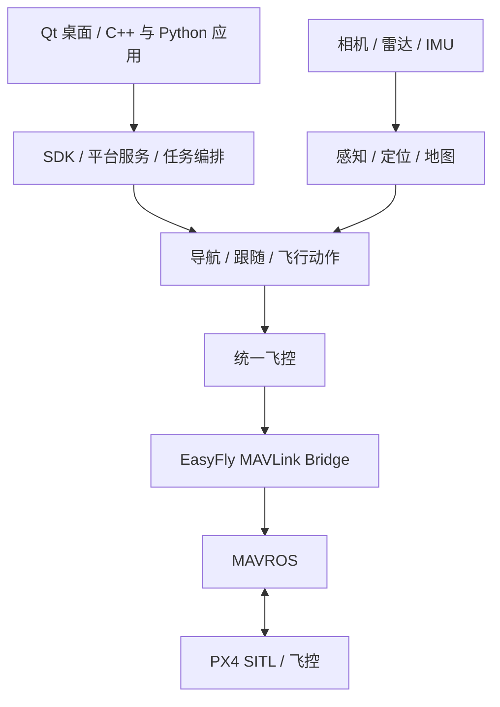

# EasyFly

基于 **ROS 2 Humble、PX4 和 Gazebo Classic** 的自主无人机开发平台，将传感器、感知定位、地图、规划控制、任务编排和桌面操作组织在同一工作区中。

EasyFly 面向自主飞行算法开发、仿真联调和任务验证，提供 C++ / Python SDK 与 Qt 桌面应用。当前处于**仿真内测阶段**：核心任务链已有 PX4/Gazebo 验证，整体验收、长期稳定性和实机飞行验证仍在推进。

**首次部署与内测请先阅读 [内测手册](内测手册.md)**，其中包含完整安装准备、构建步骤、功能用例、仿真飞行入口、通过标准和问题记录模板。

## 当前能力

| 方向 | 已有实现 | 支持范围 |
| --- | --- | --- |
| 连接与仿真 | 本机仿真启动、已有平台 DDS 连接、MAVROS 通信配置、QGC 转发 | 桌面统一管理；真实串口、远端 QGC 和双机 DDS 需分别验证 |
| 感知与跟踪 | YOLO ONNX、AprilTag、椭圆/彩线检测、CSRT、SORT、ID 融合和目标预测 | 部分组件使用独立启动入口；检测输出不直接授予飞行权限 |
| 定位与建图 | FAST-LIO、地面分割、障碍几何与关联、占据地图、雷视投影 | FAST-LIO 为既有完整链的默认定位后端 |
| 视觉惯性定位 | OpenVINS Gazebo 单目接入、输入守卫、状态与位姿、机体对齐观测 | **仅观测，导航仍拒绝**；地图接入和完整受管飞行未完成 |
| 规划与控制 | A*、EGO、combined 导航、目标跟随、起降与轨迹执行 | 指定场景和参考任务已有验证；包含取消、失效及外部接管处理 |
| 任务与 SDK | 顺序任务、区域搜索、任务服务、C++ SDK 和 Python 绑定 | Python 绑定复用 C++ SDK；动作结果与控制权释放分别跟踪 |
| 精准降落与云台 | 固定下视相机/静止标签板的精准降落、模拟云台 | 精准降落使用独立 D5 配置；真实云台后端未完成 |
| 桌面工具 | 任务编辑、同帧感知显示、二维视图、可选内嵌 RViz、录像与独立回放 | 默认只读；任务执行、导入和元数据写入需要显式启用 |

车辆重识别、独立深度估计、集群规划、独立轨迹优化，以及 Web、Mesh 等模块仍有预留骨架。包能够被发现或编译，不代表对应功能已实现；桌面录像、MAVROS 的 UDP 通信也不能作为独立媒体包、UDP 协议包的完成依据。

## 架构与目录



飞行控制统一通过 `easyfly_flight_control → easyfly_mavlink_bridge → MAVROS` 下发；任务和算法通过约定的消息、Action、服务及会话协议协作。源时间、坐标系、输入有效性、动作所有权和取消排空由各层明确处理。

```text
easyfly_ws/
├── src/
│   ├── communication/       # 驱动、飞控协议与媒体预留模块
│   ├── perception/          # 预处理、检测、跟踪、定位与融合节点
│   ├── execution/           # 任务状态机、规划与控制
│   ├── application/         # SDK、服务、任务与仿真入口
│   ├── algorithms/          # 可复用计算库与能力接口
│   ├── easyfly_common/      # 公共消息、工具与任务格式
│   ├── easyfly_ui/          # 桌面、连接管理、观察与控制适配
│   ├── simulation/          # 场景、模型、插件及仿真兼容层
│   └── third_party/         # 外部算法、运行库、设备 SDK 与工具资料
├── models/                  # 推理模型资产
├── tools/                   # 算法检查、场景准备与诊断工具
├── scripts/                 # 开发与诊断辅助脚本
├── build_all.bash           # 全量构建包装
├── build_layer.bash         # 按层及依赖构建
└── 内测手册.md              # 安装、操作与测试指南
```

项目维护的算法部分目前包含 **4 个能力 API 和 17 个计算组件**。普通算法库通过安装后的 CMake target 或 Python module 消费；FAST-LIO、EGO、OpenVINS 等完整 ROS 工程保留其结构，通过平台适配接入。新增算法参见 [算法索引](src/algorithms/README.md) 和 [接入指南](src/algorithms/integration-guide.md)。

## 环境与安装准备

当前主要开发环境为 **Ubuntu 22.04 x86_64**。完整平台依赖以下已验证版本及兼容输入：

| 组件 | 当前基线与要求 |
| --- | --- |
| ROS 2 | Humble，使用系统兼容的 Python 3.10 / GCC 11 环境 |
| PX4 | 1.16.2，以及项目审核过的仿真 HRT 兼容构建；部分场景另需磁力计采样间隔修复 |
| Gazebo Classic | 11.10.2，私有兼容层同时校验相关系统头文件和库的指纹 |
| Fast DDS | 2.6.11，受管场景使用项目私有兼容库 |
| Qt / OpenCV | Qt5；本机基线为 Qt 5.15.3、OpenCV 4.5.4 |
| 内嵌 RViz | 启用时要求 common/rendering/default_plugins 11.2.26 |
| 检测运行库 | ONNX Runtime C/C++ SDK 1.23.2 与项目模型；CUDA 还需匹配宿主机依赖 |
| 设备与定位依赖 | Livox SDK、librealsense、GeographicLib 数据；OpenVINS 需要 Ceres |

完整安装需要准备系统依赖、PX4 源码与原始构建、兼容输入、ORT SDK、模型和场景资源。**仅克隆 Git 仓库不能得到完整可运行环境**：ORT 载荷、构建目录和本地缓存不入库，RealSense 嵌套仓库还需核对实际源码及其登记缺口。

安装步骤和检查清单见 [内测手册](内测手册.md)。部署时保留精确版本与文件指纹；遇到不匹配应使用已审核输入或重新适配，不通过删除版本/SHA 校验启动。当前尚无经过完整验收的自包含 deb/AppImage 安装包。

## 快速开始

### 使用已部署的完整平台

从应用菜单打开 **EasyFly**，进入“连接与仿真”：

1. 新建连接，选择“启动本机仿真”。
2. 首次检查使用 `base_sim` 和 `primitives_sparse_seed42_v1`；需要感知、建图与导航时选择 `navigation_dev`。
3. 核对场景、PX4 兼容输入、DDS domain 和模拟时间，点击“启动仿真并连接 DDS”。
4. 在总览确认真实连接和新鲜状态，再按内测手册开展观察或任务测试。

安装环境已加载时，也可启动统一入口：

```bash
ros2 run easyfly_connection_manager easyfly_connections
```

桌面包含七项导航：**连接与仿真、运行总览、任务中心、相机与感知、空间视图、记录与回放、诊断与设置**。启动后台不会自动解锁或提交飞行任务。QGC 联网维护具有双向控制能力，与 EasyFly 的任务执行、导入及参数修改互斥。

“结束观测”或关闭工作窗口会保留后台。停止后台需通过管理入口，并满足新鲜、未解锁、在地面和无未决任务等条件。详细操作见 [连接管理说明](src/easyfly_ui/easyfly_connection_manager/README.md) 与 [桌面操作说明](src/easyfly_ui/easyfly_desktop/OPERATIONS.md)。

### 通过终端选择场景

使用本次完整安装及其登记的 underlay。将下面两个占位路径替换为实际部署目录；兼容目录应包含 `compatibility.json` 和 `px4-input/`：

```bash
source /opt/ros/humble/setup.bash
export EASYFLY_INSTALL=/absolute/path/to/verified/install
source "$EASYFLY_INSTALL/setup.bash"
export EASYFLY_PX4_HRT_COMPAT_DIR=/absolute/path/to/reviewed-px4-compat
export ROS_DOMAIN_ID=84
export ROS_LOCALHOST_ONLY=1

ros2 run easyfly_sim_launcher scene_catalog list --json
ros2 run easyfly_sim_launcher scene_catalog validate primitives_sparse_seed42_v1 --json
ros2 launch easyfly_sim_launcher profile.launch.py \
  profile:=navigation_dev scene:=primitives_sparse_seed42_v1 headless:=true rviz:=false
```

本例只启动平台，不发送飞行 Goal；不要与 UI 已启动的后台并行运行。场景离线校验通过只表示资源满足检查，不代表当前飞机、地图或任务已就绪。`headless:=true` 关闭 Gazebo 客户端，相机渲染仍需要可用的图形环境。

| Profile | 用途 |
| --- | --- |
| `base_sim` | 基础飞控状态，不启动 SLAM 或导航链 |
| `full_perception` | 完整感知及相关平台能力 |
| `navigation_dev` | 导航开发，默认 combined 策略 |
| `landing_dev` | 感知/TF 准备；精准降落使用独立配置和入口 |
| `hardware_unverified` | 未验证硬件占位，禁止作为可运行方案启动 |

当前场景目录共 17 项，其中 11 项已登记，覆盖基础几何、仓库、住宅、书店、办公室、医院、森林、赛道和街区。以安装目录的 `supported_profiles` 与资源检查为准；`empty` 等草稿不能通过受管选择启动。场景和参考任务说明见 [仿真启动器](src/application/a3_mission/easyfly_sim_launcher/README.md)。

### 仅构建独立只读桌面

已有兼容的系统 ROS、Qt 和开发依赖时，可以先构建桌面的六包依赖闭包。它可以观察已有平台、编辑本地草稿；完整仿真和连接管理需另外部署。

在工作区根目录的新终端执行，只加载系统 ROS。以下使用独立目录，关闭录像和内嵌 RViz：

```bash
source /opt/ros/humble/setup.bash
colcon --log-base log-readonly build --base-paths src \
  --build-base build-readonly --install-base install-readonly \
  --packages-up-to easyfly_desktop --executor sequential \
  --cmake-args -DBUILD_TESTING=ON \
  -DEASYFLY_ENABLE_MEDIA=OFF -DEASYFLY_ENABLE_RVIZ_EMBED=OFF
source install-readonly/setup.bash
ros2 run easyfly_desktop easyfly_desktop
```

默认使用模拟时间，没有 `/clock` 时实时数据不可用。连接使用系统时间的真实数据源时，按 [桌面说明](src/easyfly_ui/easyfly_desktop/README.md) 选择 `--system-time`，并匹配实际 domain 和 topic。

完整平台的 SDK 准备、编译参数与可选能力安装见内测手册。`build_all.bash` 和 `build_layer.bash` 是构建包装，不负责自动安装这些依赖或准备 PX4 兼容输入；按层选择可先用 `./build_layer.bash p --dry-run` 查看。

## 测试与内测

测试按“安装检查 → 软件组件 → 只读观察 → 指定仿真任务 → 异常与压力专项”推进。每轮保留源码、依赖、配置和原始结果；行为检查、规范检查、跳过项及硬件未测项分别报告。

上面的独立桌面构建可执行软件检查：

```bash
export ROS_LOCALHOST_ONLY=1
export ROS_DOMAIN_ID=226
export QT_QPA_PLATFORM=offscreen
colcon --log-base log-readonly-test test --base-paths src \
  --build-base build-readonly --install-base install-readonly \
  --packages-select easyfly_msgs easyfly_core easyfly_mission_format \
  easyfly_ui_control easyfly_ui_bridge easyfly_desktop \
  --executor sequential --ctest-args -j1 --output-on-failure
colcon test-result --test-result-base build-readonly --verbose
```

这是软件/夹具检查，不证明真实图形渲染或飞行通过；GUI 人工检查应使用正常图形环境。完整平台还需包含 `easyfly_desktop_tests` 等联合用例。集成测试含固定 domain，按手册串行运行。

导航、跟随、电池、场景参考任务和精准降落有**显式 SITL 验收入口**，会发送仿真飞行动作，不由普通 `colcon test` 自动执行。参数、前提、取消与收尾标准统一见 [内测手册](内测手册.md)。

需要区分：**请求接受、动作终态、控制权释放、实际落地、进程正常退出**。取消 ACK 或窗口关闭不能替代执行结束的证据。

## 当前验证边界

- 2026-10-18 的 ALG-9 基线完成两种安装各 91 包构建和独立消费；9 类 SITL 的最新结果为 8 通过、1 失败，整体验收未签收。后续新增包不由该历史矩阵自动覆盖。
- 2026-10-20 的基础场景检查覆盖 11 个登记场景，99/99 所属子进程正常退出；范围为地面启动、时钟/状态和正常停止，没有新增飞行资格。见 [机器记录](src/simulation/easyfly_gazebo_worlds/evidence/base-sim-startup-20261020.json)。
- OpenVINS 输入交付与退出已做修复并有本机压力/回放回归，仍仅提供观测。D435i 当前提供采集预设，设备标定、双目 VIO 和导航需继续验证。
- 搜索结束后的 `semantic_map` 退出崩溃、另一次尚未唯一定位的 DDS reader 崩溃以及全量规范检查欠账仍有未关闭记录。正常复跑不能自动关闭历史故障。
- 长期稳定性、完整硬件链、台架/HIL 与实机飞行尚未完成。当前结果不代表任意场景、任意设备或任意路线均可用。

## 开发与文档

| 主题 | 入口 |
| --- | --- |
| 完整安装、内测用例、故障排查和报告 | [内测手册](内测手册.md) |
| 桌面与连接操作 | [连接管理](src/easyfly_ui/easyfly_connection_manager/README.md) · [桌面操作](src/easyfly_ui/easyfly_desktop/OPERATIONS.md) |
| 仿真与场景 | [仿真启动器](src/application/a3_mission/easyfly_sim_launcher/README.md) · [PX4 兼容输入](src/simulation/easyfly_px4_sitl/README.md) · [Fast DDS 兼容层](src/simulation/easyfly_fastdds_compat/README.md) |
| SDK | [C++ SDK](src/application/a1_sdk/easyfly_core/README.md) · [Python 绑定](src/application/a1_sdk/easyfly_pybind/README.md) |
| 算法开发 | [算法索引](src/algorithms/README.md) · [接口契约](src/algorithms/interface-contracts.md) · [构建约定](src/algorithms/build-conventions.md) · [新增算法接入](src/algorithms/integration-guide.md) |
| 定位与检测 | [OpenVINS](src/perception/p3_tracking/easyfly_openvins_integration/README.md) · [椭圆/彩线](src/algorithms/classical-detection.md) · [D435i 采集](src/application/a1_sdk/easyfly_params/config/sensors/README.md) |
| 外部依赖与来源 | [第三方清单](src/third_party/catalog.json) · [来源与补丁](src/third_party/sourcing-and-patches.md) · [推理运行库](src/third_party/runtimes/README.md) |

新增后端应同时提交实现、平台适配、配置、来源/许可证与对应检查。能力声明只填写实际支持项；变更公共消息或 C++ ABI 时同步重编译消费者。

`docs/`、开发计划、阶段验收报告和 `artifacts/` 中的本地证据按当前策略不入 Git。源码仓库中的使用说明与本轮交付包共同构成部署依据；需要复现历史验收时，应另外取得相应原始证据。

## 许可证

EasyFly 自有代码采用 [Apache License 2.0](LICENSE)，署名为 `EasyFly Project`。

第三方源码、设备 SDK、模型、场景资源及本地移植保留各自许可证和版权通知，根许可证不替代这些声明。部分历史资产的来源/许可仍有待补全项，具体见 [第三方来源与补丁](src/third_party/sourcing-and-patches.md) 和 [模型资产登记](src/third_party/model-assets.provenance.json)。
